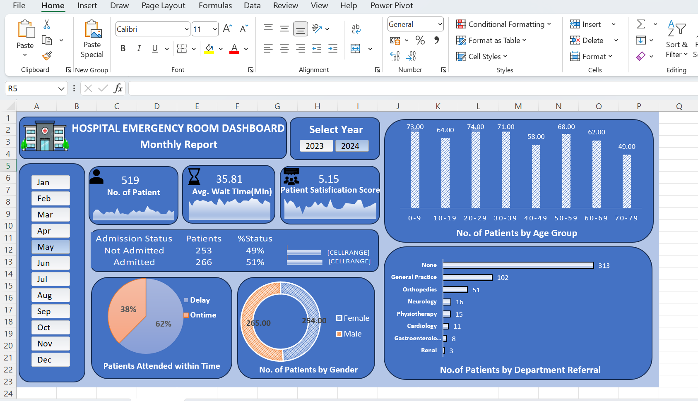

# Hospital_Emergency_Room_Dashboard
An interactive Excel dashboard analyzing hospital emergency room data, patient visits, waiting times, admissions, satisfaction scores, demographics, and department referrals using Power Query, Power Pivot, DAX, and PivotCharts.

## Dashboard Preview

## 📌 Project Overview

The Hospital Emergency Room Dashboard is a data analytics project developed using Microsoft Excel to analyze and visualize hospital emergency room operations. It provides insights into patient visits, waiting times, admission status, patient satisfaction, demographics, and department referrals.

The dashboard transforms raw hospital data into meaningful visualizations, helping users understand patient trends, monitor key performance indicators (KPIs), and identify areas for improvement in emergency room services.

## 🎯 Project Objectives

- Analyze the total number of patients visiting the emergency room.
- Monitor average patient waiting time.
- Evaluate patient satisfaction scores.
- Analyze patient admission status and demographics.
- Identify trends in patient visits over time.
- Examine department referrals and patient distribution.
- Enable interactive, month-wise analysis using slicers.

## 🛠️ Tools & Technologies

- Microsoft Excel – Dashboard creation and data visualization
- Power Query – Data cleaning and transformation
- Power Pivot – Data modeling and relationships
- DAX – Calculated columns and KPI measures
- PivotTables & PivotCharts – Data summarization and visualization
- Slicers & Calendar Table – Interactive date-based filtering

## 📊 Key Dashboard Features

- Patient Overview: Tracks the total number of emergency room visits.
- Waiting Time Analysis: Measures average waiting time and identifies delays.
- Patient Satisfaction: Analyzes satisfaction scores to understand patient experience.
- Admission Analysis: Compares admitted and non-admitted patients.
- Demographic Analysis: Examines patient age groups and gender distribution.
- Department Referral Analysis: Identifies departments receiving patient referrals.
- Patient Visit Trends: Displays changes in patient visits over time.
- Interactive Month-Wise Filtering: Allows users to explore data for specific months.

## 🔄 Project Workflow

- Imported raw hospital data into Excel.
-  Cleaned and transformed the data using Power Query.
- Created a calendar table for date-based analysis.
- Built relationships between tables using Power Pivot.
- Created calculated columns and measures using DAX.
- Developed PivotTables and PivotCharts to analyze key metrics.
- Designed an interactive dashboard with slicers.
- Analyzed the results to identify trends and performance indicators.

## 💡Skills 

- Data cleaning and preprocessing
- Exploratory data analysis
- Data modeling
- DAX calculations
- Dashboard design
- Data visualization
- Analytical thinking and interpretation
